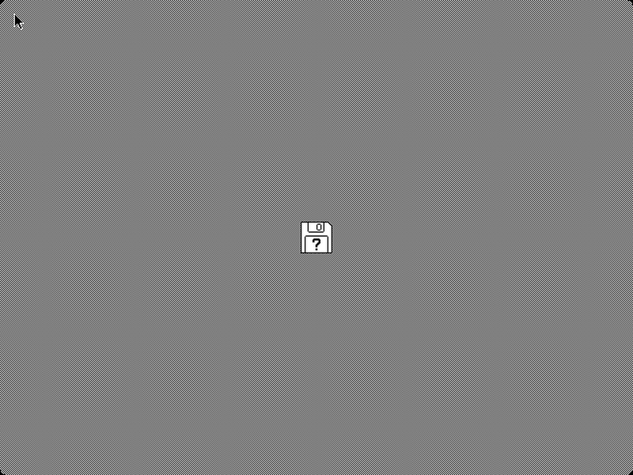
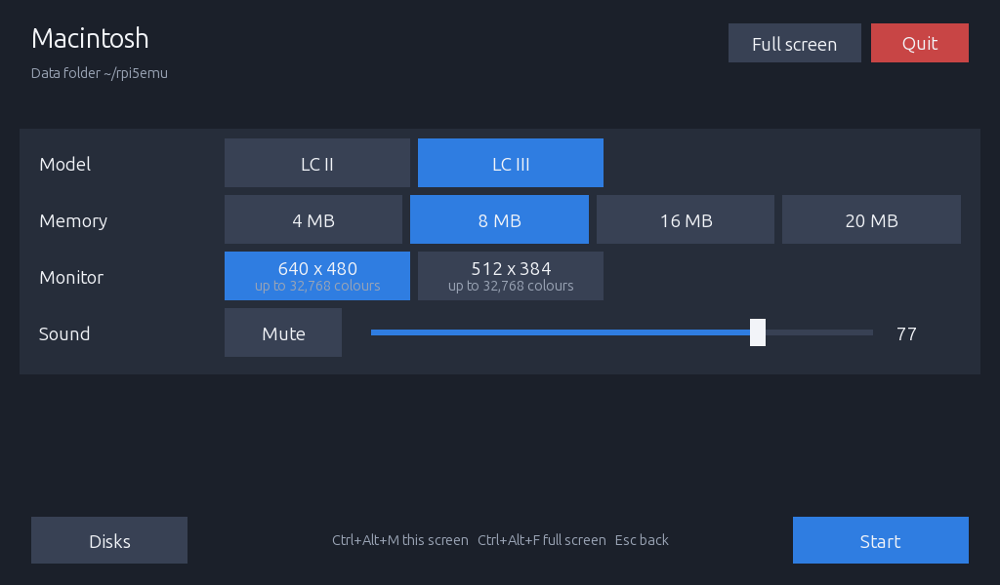
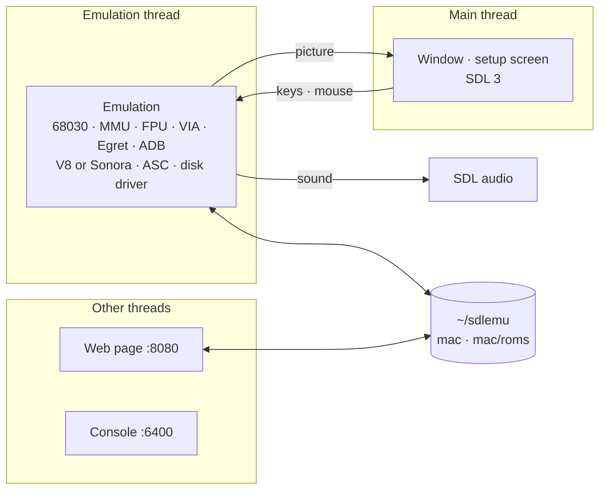

<h1 align="center">sdlmac3</h1>

<p align="center">
  <b>A Macintosh LC II or LC III in an SDL 3 window on Linux or macOS.</b><br>
  68030 with its MMU and FPU, 640×480 in 256 colours, up to 20 MB, Mac OS 7.6.1, disk images of any size in three drives.
</p>

<p align="center">
  
  
  
  
  
  
</p>

<p align="center">
  <b>Work in progress:</b> not everything has been tested, and games and demos may or may not
  work satisfactorily.
</p>

<p align="center">
  
  <br>
  <sub>The LC III asking for a system disk, on the Pi.</sub>
</p>

sdlmac3 runs [esp32mac3](https://github.com/rlucencic/esp32mac3)'s Mac on 64-bit Linux (arm64 and amd64) and Apple Silicon macOS. SDL 3 provides the window, sound and input. The machine is the
same code as on the ESP32 boards: esp32mac3's platform-independent core and
[esp32emu](https://github.com/rlucencic/esp32emu)'s CPU core, on
[sdlemu](https://github.com/rlucencic/sdlemu), the family's desktop runtime: a setup
screen in the window, sound, the host's keyboard and mouse, a web page on your network and a
console.

It belongs to the SDL desktop family of the ESP32 emulators:
[sdlzx](https://github.com/rlucencic/sdlzx) (ZX Spectrum),
[sdlcpc](https://github.com/rlucencic/sdlcpc) (Amstrad CPC),
[sdlcbm](https://github.com/rlucencic/sdlcbm) (Commodore 64 and 128),
[sdlcoco](https://github.com/rlucencic/sdlcoco) (Tandy Color Computer 2 and 3),
[sdlgs](https://github.com/rlucencic/sdlgs) (Apple IIGS),
[sdlmsx](https://github.com/rlucencic/sdlmsx) (MSX1 and MSX2),
[sdlxl](https://github.com/rlucencic/sdlxl) (Atari 800XL and 130XE),
[sdlste](https://github.com/rlucencic/sdlste) (Atari STE),
[sdlpc](https://github.com/rlucencic/sdlpc) (IBM PC/XT and PC/AT),
[sdlmac](https://github.com/rlucencic/sdlmac) (Macintosh Plus, SE, Classic),
[sdlmac2](https://github.com/rlucencic/sdlmac2) (Macintosh LC and II),
[sdlarc](https://github.com/rlucencic/sdlarc) (Acorn Archimedes),
[sdlami](https://github.com/rlucencic/sdlami) (Amiga 500, 2000, 600, 1200).

## Features

**The machines**
- **68030 with its paged MMU** ([Musashi](https://github.com/kstenerud/Musashi)
  core, its MMU rewritten for these ROMs): the ROMs build their own page
  tables and switch between 24-bit and 32-bit addressing as on the real
  thing; and a 68882 FPU, as if the optional chip were fitted
- **Macintosh LC II**: 4, 6, 8 or 10 MB (4 MB on the board and a SIMM pair);
  built-in video at 640×480 in black and white up to 256 colours, or
  512×384 up to thousands (32,768); Egret for the ADB keyboard and mouse, the clock
  and parameter RAM; the V8's Apple Sound Chip
- **Macintosh LC III**: 4, 8, 16 or 20 MB; Sonora's full 32-bit memory map
  and 1 MB of video RAM (up to thousands of colours at 640×480 too, as a
  real LC III with its VRAM SIMM; with only the 512 KB on its board it
  has 256 there); Egret; Sonora's stereo sound
- A 13-inch (640×480) or 12-inch (512×384) monitor, chosen on the setup
  screen, whose buttons say how many colours each one gets on the model
  (LC II: up to 256 or 32,768; LC III: up to 32,768 on both); 256 colours
  by default on both
- **Always in real time** (sound, clock, mouse): the 68030 runs as fast as
  the Pi keeps up, at most the model's own speed. On the Pi both
  run at their own speed (the LC III's 25 MHz with about a fifth of a core);
  the web page shows the speed live
- The startup chime, system beeps and sound through the Apple Sound Chip,
  through the Pi's sound output
- The clock is set from the Pi's time; each model's parameter RAM (the
  control panels' settings) is kept across power-offs

**Disks**
- **Three drives** for disk images of any size, floppies and hard disks
  alike, through a fast replacement of the Mac's disk driver (from esp32mac)
- Mac OS 7.6.1 tested on both machines (at every memory size on the
  desktop build)
- Raw images (`.dsk`, `.img`, `.hfv`), Disk Copy 4.2 images (`.image`),
  partitioned hard disk images (`.hda`), CD images (`.iso`, `.toast`,
  locked as CDs are) and uncompressed `.dmg` images (read-only)
- **Mac archives straight from the old download sites**: StuffIt (`.sit`,
  `.sea`), Compact Pro (`.cpt`), BinHex (`.hqx`) and MacBinary (`.bin`)
  files dropped on the web page are unpacked in your browser and put on a
  disk image of their own, ready to insert
- **New blank disks** from the web page (800 KB and 1.4 MB floppies, 20,
  100 or 500 MB hard disks) or the setup screen (800 KB); the Mac offers to
  initialise them
- Disks inserted while the Mac runs appear on the desktop; ejecting one on
  the Mac frees the drive

**Around it**
- **A window** of its own on the Pi's desktop (X11 or Wayland), resizable, full screen
  with Ctrl+Alt+F; the picture in the machine's shape, smoothly scaled
- **Setup screen** in the window, first thing at start and any time with Ctrl+Alt+M:
  model, memory, monitor, the sound's volume, the drives and their images (insert, eject, new
  blank ones), Start / Back / Restart, Reset
- **The Pi's keyboard and mouse**: keys by position, as the boards' Bluetooth keyboards;
  a click in the window gives the mouse to the machine, Ctrl+Alt+G takes it back
- **Web page** at `http://<the Pi>:8080/`: drop images (or ZIP files) onto it, insert
  them, make blank ones, and watch the machine and its drives live
- **Sound** through SDL (PipeWire, PulseAudio or ALSA), the machine paced by the clock
- **Console** on the terminal and on `127.0.0.1:6400`: keys, typing, drives, screenshots

<p align="center">
  
  <br><sub>The setup screen in the window, before the Mac starts</sub>
</p>

## Getting started

### 1. What you need

- 64-bit Linux (including Raspberry Pi 5) or Apple Silicon macOS with SDL 3.2 or newer. See [desktop build dependencies](https://github.com/rlucencic/sdlemu#building).
- [esp32emu](https://github.com/rlucencic/esp32emu), [sdlemu](https://github.com/rlucencic/sdlemu)
  and [esp32mac3](https://github.com/rlucencic/esp32mac3), cloned next to this project
- The ROMs (below)

### 2. Build

```sh
git clone https://github.com/rlucencic/esp32emu.git
git clone https://github.com/rlucencic/sdlemu.git
git clone https://github.com/rlucencic/esp32mac3.git
git clone https://github.com/rlucencic/sdlmac3.git && cd sdlmac3
cmake -S . -B build -G Ninja && cmake --build build
```

### 3. ROMs

The LC II's (512 KB) or the LC III's (1 MB) in the data folder's `mac/roms/`
(`~/sdlemu/mac/roms`), under any name (esp32mac3's: `lc2.rom`, `lc3.rom`):
it is found by its checksum. Not part of this repository.

### 4. First start

1. `build/sdlmac3`: the setup screen opens in a window.
2. Choose the model and click **Start**.
3. Put images into `~/sdlemu/mac/`, drop them on the window or the web page, and
   insert them on the setup screen's **Disks** page.

## Using it

| To | Do |
|---|---|
| Get back to the setup screen | Ctrl+Alt+M (the machine waits meanwhile) |
| Full screen | Ctrl+Alt+F |
| Give the mouse to the machine, take it back | A click in the window; Ctrl+Alt+G |
| Run as fast as it goes (warp) | Ctrl+Alt+W, again for real speed |
| Take a screenshot | Ctrl+Alt+S (into `~/sdlemu/screenshots`), or the console's `s` |
| Insert an image | The setup screen's **Disks** page, drop it on the window or the web page, or name it on the command line: `build/sdlmac3 MacOS761.hda` |
| Start straight into the machine | `build/sdlmac3 -S`, with the setup screen's rows as `--choice`: `build/sdlmac3 -S --choice "Model=LC III" --choice "Memory=20 MB"` |
| Show the window on another computer | Log in with `ssh -C -Y <the Pi>` and start it there: fine for still pictures; games want the Pi's own monitor |

Images live in `~/sdlemu/mac/` (sdlmac's and sdlmac2's too), settings in
`~/.config/sdlemu/settings.ini`; the inserted images are remembered across starts.
`build/sdlmac3 --help` lists the options.

**Keyboard**: by position, as on Apple's Extended Keyboard (US). Command is
the Windows/⌘ key, Option is Alt, Control is Ctrl; Backspace is Delete,
Delete is the forward delete, Insert is Help, Num Lock is Clear; F1-F15,
Home, End, Page Up and Page Down and the keypad as themselves.

## How it works



- **[esp32mac3](https://github.com/rlucencic/esp32mac3)'s `components/mac3`**: the Mac,
  platform independent: the same code runs on the ESP32 boards.
- **`src/`**: the glue, esp32mac3's `main/main.c` ported: memory, ROMs, settings, keyboard map,
  drives and status.
- **[sdlemu](https://github.com/rlucencic/sdlemu)**: the window, the setup screen, sound,
  input, the web page, the console, the data folder and the settings.
- **[esp32emu](https://github.com/rlucencic/esp32emu)**: the CPU core (Musashi 68030 + MMU).

## Development

```sh
../sdlemu/tools/pi.sh sdlmac3 build        # from another computer: sync to the Pi, build there
../sdlemu/tools/pi.sh sdlmac3 run          # its window on this computer (ssh -C -Y)
../sdlemu/tools/pi.sh sdlmac3 headless     # no window: drive it through the console
../sdlemu/tools/console.sh i 's /tmp/shot.png'
```

`CLAUDE.md` has the details: the layout, how it was ported, the checks; esp32mac3's own
`CLAUDE.md` has the machine's.

## Limitations

- Checked on the Pi through its console and screenshots: the LC II and LC III at full speed to their disk icon. Not yet by hand
  in the window, with the sound heard, or with much software.
- Over X forwarding (`ssh -Y`) every changed picture crosses the network: 8 to 15 a second.
- RAM sizes: the LC III takes 4, 8, 16 or 20 MB, the sizes its ROM finds
  with the RAM in one piece (12 MB isn't one of them).
- The CPU's pace for each model is an estimate, not yet calibrated against
  a real LC II or LC III.
- MMU faults don't raise exceptions, so no virtual memory.
- No SCSI devices, serial ports, AppleTalk, printer or PDS cards. The Mac's
  volume setting is ignored.
- Disk images are presented through the floppy driver: copy-protected
  originals that talk to the floppy hardware directly don't work.

## Credits

- [Musashi](https://github.com/kstenerud/Musashi) by Karl Stenerud (MIT
  licence), via Matt Evans' [fork](https://github.com/evansm7/Musashi) for
  embedded use
- [MAME](https://www.mamedev.org)'s Mac LC II and LC III drivers by R.
  Belmont (V8, Sonora, pseudo-VIA, ASC; hardware tests by Doug Brown), its
  Sonora video by O. Galibert, and its 68030 MMU, the reference for how
  these machines' chips behave
- Linux's `via-cuda.c` and QEMU's Cuda, for the Egret packets
- [Mini vMac](https://www.gryphel.com/c/minivmac/) and Matt Evans'
  [umac](https://github.com/evansm7/umac), via esp32mac
- [The Unarchiver](https://theunarchiver.com)'s XADMaster by Dag Ågren (LGPL),
  the reference for the StuffIt and Compact Pro formats (via esp32mac)
- [SDL](https://libsdl.org) 3 for the window, the sound and the input

## Licence

[MIT](LICENSE).

Apple, Macintosh and Mac are trademarks of Apple Inc. This project contains
no Apple code; you need your own ROM images and system software.
